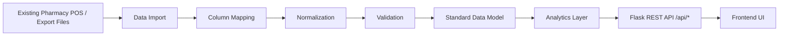

# Pharmacy Intelligence

## Table of Contents

- [Project Overview](#project-overview)
- [Problem Statement](#problem-statement)
- [Proposed Solution](#proposed-solution)
- [Key Features](#key-features)
- [System Architecture](#system-architecture)
- [Technology Stack](#technology-stack)
- [Project Structure](#project-structure)
- [How It Works](#how-it-works)
- [Installation and Setup](#installation-and-setup)
- [Running Locally](#running-locally)
- [Environment Variables and Configuration](#environment-variables-and-configuration)
- [Usage Guide](#usage-guide)
- [API Overview](#api-overview)
- [Security Considerations](#security-considerations)
- [Testing and Validation](#testing-and-validation)
- [Deployment](#deployment)
- [Current Project Status](#current-project-status)
- [Known Limitations](#known-limitations)
- [Future Improvements](#future-improvements)
- [Contributing](#contributing)
- [License](#license)
- [Author and Credits](#author-and-credits)

## Project Overview

Pharmacy Intelligence is a demo analytics platform for pharmacy operations. It aggregates pharmacy sales, purchases, inventory, and product datasets, then exposes business metrics and operational insights through a Flask API and a lightweight responsive frontend.

The project is designed for a pharmacy owner or operations manager who needs an operational view of sales performance, inventory risk, expiry exposure, dead stock, product profitability, and demand forecasting without replacing the existing point-of-sale or ERP system.

This repository is intentionally a working prototype rather than a production-grade system. It is built to demonstrate a realistic analytics architecture for a pharmacy environment using synthetic data and a modular import/normalization flow.

## Problem Statement

Pharmacies often collect useful operational data in spreadsheets, POS exports, or custom software. However, those sources are usually fragmented and inconsistent across tables, formats, and naming conventions. Managers often need answers to questions such as:

- Which products are generating the most revenue and profit?
- Which items are at risk of stockout or expiry?
- Which products are moving slowly or sitting as dead stock?
- How does demand vary by weekday, hour, and category?
- Which products are frequently purchased together?

Without a unified analytical layer, this information is difficult to extract reliably and consistently.

## Proposed Solution

This project introduces a thin analytics layer that sits above raw pharmacy data. Instead of coupling business logic to a single export format, the system follows a standard path:

1. Import raw data from CSV or Excel.
2. Detect and map source columns to a canonical schema.
3. Normalize the data into a standard structure.
4. Validate required fields and data quality rules.
5. Compute metrics in the backend using pandas-based analytics.
6. Expose the results through a REST API consumed by the frontend.

This architecture keeps the analytics logic independent from the source system and allows future support for additional pharmacy software exports.

## Key Features

- Revenue, profit, and unit-trend analysis across time ranges.
- Inventory monitoring with low-stock alerts and reorder suggestions.
- Dead-stock detection based on inactivity thresholds.
- Expiry risk segmentation by 7-, 30-, and 90-day horizons.
- Top performers and high-volume-low-margin product analysis.
- Association rules to identify frequently purchased combinations.
- Demand forecasting using a lightweight linear-trend model.
- CSV/Excel upload and mapping workflow.
- Data-quality validation for missing values, duplicates, invalid dates, and incomplete rows.
- Responsive RTL-first frontend with Chart.js-based visualizations.

## System Architecture



The backend is the source of truth for all analytics logic. The browser only receives JSON payloads from the API and does not access the raw dataset or analytics code directly.

## Technology Stack

- Python 3
- Flask
- pandas
- numpy
- openpyxl
- vanilla JavaScript
- Chart.js
- HTML5/CSS3

## Project Structure

```text
pharmacy-intelligence/
├── README.md
├── requirements.txt
├── index.html
├── backend/
│   ├── __init__.py
│   ├── app.py
│   ├── analytics/
│   │   ├── association_rules.py
│   │   ├── demand_forecast.py
│   │   ├── expiry_analysis.py
│   │   ├── inventory_analysis.py
│   │   ├── profit_analysis.py
│   │   └── sales_analysis.py
│   ├── data_processing/
│   │   ├── loader.py
│   │   ├── normalizer.py
│   │   └── validator.py
│   ├── importers/
│   │   └── file_importer.py
│   ├── routes/
│   │   └── api.py
│   └── services/
├── frontend/
│   ├── index.html
│   ├── css/
│   └── js/
├── data/
│   ├── inventory.csv
│   ├── products.csv
│   ├── purchases.csv
│   └── sales.csv
├── scripts/
│   └── generate_data.py
└── tests/
```

## How It Works

The analytics model expects a normalized data structure for `sales`, `purchases`, `inventory`, and `products` datasets. The data import pipeline matches loosely named source columns to the internal standard using alias dictionaries that include Arabic and English header variations.

After normalization, the backend validates the table and computes dashboard metrics from the in-memory pandas DataFrames. The frontend reads those values through API endpoints and renders charts, KPI cards, and summary panels.

This project stores data in memory during runtime rather than in a database. That makes the prototype simple and fast to run, but it also means the dataset is not persisted across restarts unless regenerated.

## Installation and Setup

Clone the repository and install the project dependencies.

```bash
cd pharmacy-intelligence
python -m venv .venv
source .venv/bin/activate   # Linux/macOS
# or .venv\Scripts\activate   # Windows
python -m pip install --upgrade pip
python -m pip install -r requirements.txt
```

## Running Locally

Start the Flask backend:

```bash
cd pharmacy-intelligence
python backend/app.py
```

This serves the application at:

- http://localhost:5000

The app serves both the API and the frontend from the same local server.

To regenerate the synthetic dataset used by the demo UI:

```bash
cd pharmacy-intelligence
python scripts/generate_data.py
```

## Environment Variables and Configuration

The application uses the following runtime configuration options:

- `PORT`: server port for the Flask app, default is `5000`.
- `FLASK_DEBUG`: set to `1`, `true`, `yes`, or `on` to enable debug mode.
- `window.PHARMACY_API_BASE`: optional browser-side override used by the frontend when the backend is hosted separately from the static site.

No secret keys or credentials are required for the default local demo workflow.

## Usage Guide

1. Open the application in a browser.
2. Select the demo mode to load the synthetic dataset and preview tables.
3. Use the dashboard to review revenue, profit, demand, stock risk, and dead-stock indicators.
4. Use the import wizard to upload a CSV or Excel file.
5. Confirm or adjust the detected column mapping.
6. Validate the imported data and apply it to the in-memory demo dataset.

## API Overview

The backend exposes analytics data through /api endpoints. Example routes include:

- `/api/dashboard`
- `/api/sales`
- `/api/inventory/low-stock`
- `/api/inventory/reorder`
- `/api/inventory/dead-stock`
- `/api/expiry`
- `/api/profit`
- `/api/associations`
- `/api/forecast`
- `/api/data-quality`
- `/api/import/detect`
- `/api/import/apply`

These endpoints return JSON payloads consumed by the frontend or used in manual validation.

## Security Considerations

- The project does not include user authentication or authorization.
- The application is intended for demo and local operational analysis, not as a production security boundary.
- The backend stores datasets in memory only; there is no persistence layer or database abstraction yet.
- The frontend is intentionally thin and does not ship the analytics logic or raw datasets to the browser.
- When hosting the frontend separately from the backend, configure CORS explicitly and avoid exposing the internal API broadly.

## Testing and Validation

At the time of writing, this repository does not include a formal automated test suite. Validation was performed by running the Flask server and exercising the main API endpoints through HTTP requests.

The project is therefore best treated as a prototype that is manually validated and documented rather than a CI-tested production service.

Example validation checks:

```bash
python -m compileall backend
curl http://127.0.0.1:5000/api/dashboard
curl http://127.0.0.1:5000/api/expiry
```

## Deployment

The application can be deployed in several ways:

### Local single-server deployment

Run `python backend/app.py` on a machine with the Python dependencies installed. This is the simplest deployment for testing and demo use.

### Static frontend + separate backend

The frontend can be served from GitHub Pages, Cloudflare Pages, or a static hosting service while the backend remains on a Python host. In that arrangement, set `window.PHARMACY_API_BASE` before the script loads.

Example:

```html
<script>
  window.PHARMACY_API_BASE = "https://your-backend-host/api";
</script>
```

## Current Project Status

This repository is a functional demonstration project with:

- a working Flask API,
- a browser-based analytics frontend,
- generated synthetic pharmacy data,
- import/normalization/validation support,
- and a set of operational analytics modules.

The project is not yet a production database-backed application and should not be treated as a complete enterprise platform without additional hardening and persistence layers.

## Known Limitations

- Data is held in memory and reset on process restart.
- There is no user authentication or explicit role-based access control.
- There is no database migration system or persistent relational schema.
- The import flow is intentionally lightweight and designed around CSV/Excel table mapping rather than enterprise connectors.
- The forecast and association-rule modules are prototype analytical methods, not a full ML pipeline.
- The frontend is intentionally static and does not include a formal framework or build pipeline.

## Future Improvements

- Add a relational database such as PostgreSQL or SQLite with migrations.
- Introduce authentication and authorization.
- Add automated unit and integration tests.
- Expand import support for more pharmacy POS systems.
- Improve data quality scoring and validation logic.
- Add more advanced analytics such as seasonality detection and anomaly alerts.
- Improve accessibility and localization coverage.

## Contributing

Contributions are welcome in the form of bug fixes, documentation updates, feature additions, and import improvements. When contributing, preserve the existing architecture and avoid replacing the project with a different stack or application model.

## License

This project currently does not declare a license in the repository. If you plan to distribute or reuse it publicly, add an appropriate open-source license before publication.

## Author and Credits

This repository is a custom implementation created for a pharmacy analytics prototype and is intended to demonstrate modular analytics and import-processing patterns for a business intelligence workflow.

The project uses synthetic demo data only and does not represent any real pharmacy or customer records.
